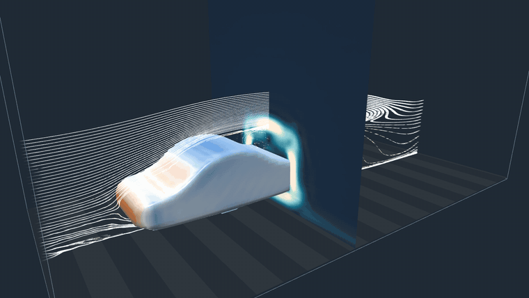
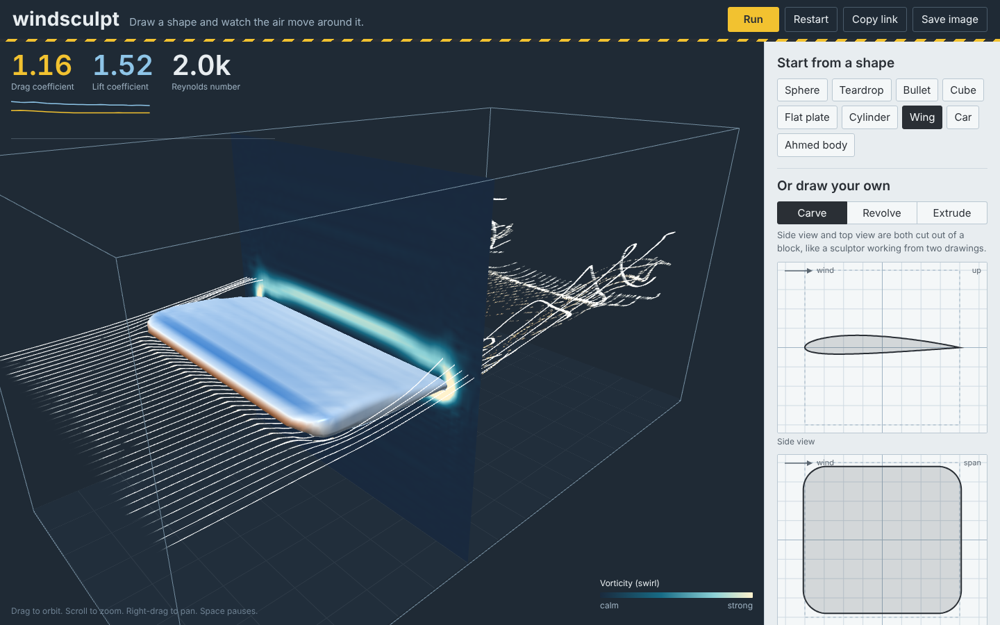

# windsculpt

[](https://github.com/aadijewargi/windsculpt/actions/workflows/ci.yml)
[](LICENSE)
[](https://aadijewargi.github.io/windsculpt/)

**Draw a shape, drop it in a 3D wind tunnel, and watch the air move around it.** windsculpt is a real-time
D3Q19 lattice Boltzmann flow solver that runs entirely on your GPU in the browser, with smoke, pressure and
vorticity views and live drag and lift coefficients.

<p align="center">
  
</p>

**[Open the wind tunnel](https://aadijewargi.github.io/windsculpt/)** (needs a browser with WebGL2: recent Chrome, Edge or Firefox on a computer with a graphics card).

## What you can do

- **Sketch a body in 3D from two drawings.** Draw a side view and a top view on graph paper. *Carve* cuts both out of a block (like a sculptor working from two drawings), *Revolve* spins the side view around the flow axis (like a lathe), and *Extrude* stretches it across the tunnel to show the 2D flow past a long beam.
- **Start from presets:** sphere, teardrop, bullet, cube, flat plate, cylinder, a NACA 2412 wing, a car, and the [Ahmed body](https://doi.org/10.4271/840300) used to benchmark car aerodynamics.
- **Tilt and turn it** (angle of attack and yaw) and watch the lift respond while the flow keeps running.
- **Put cars on a rolling road**, a moving floor like the belts in real automotive wind tunnels, so there is no floor boundary layer.
- **See the flow:** smoke streaks from a rake (sheet, curtain or grid), a slice coloured by speed (with backflow highlighted), pressure or vorticity, and the body coloured by surface pressure coefficient.
- **Read the forces:** drag and lift coefficients from momentum exchange, with a live history plot.
- **Share it:** *Copy link* encodes your drawing and settings in the URL.

<p align="center">
  
</p>

## How it works

### The lattice Boltzmann method

Instead of solving the Navier–Stokes equations directly, the tunnel is filled with a cubic grid where each
cell stores 19 particle populations $f_i(\mathbf{x}, t)$, one for each lattice velocity $\mathbf{c}_i$ of the
D3Q19 stencil (rest, 6 faces, 12 edges). Each time step they collide and then stream to the neighbouring cell:

$$
f_i(\mathbf{x} + \mathbf{c}_i,\, t + 1) = f_i(\mathbf{x}, t) - \frac{1}{\tau}\Big(f_i(\mathbf{x}, t) - f_i^{\mathrm{eq}}(\mathbf{x}, t)\Big)
$$

Density and velocity are moments of the populations, and the collision relaxes towards the discrete
Maxwell–Boltzmann equilibrium

$$
\rho = \sum_i f_i, \qquad \rho\mathbf{u} = \sum_i f_i\,\mathbf{c}_i, \qquad
f_i^{\mathrm{eq}} = w_i\,\rho\left[1 + \frac{\mathbf{c}_i\cdot\mathbf{u}}{c_s^2} + \frac{(\mathbf{c}_i\cdot\mathbf{u})^2}{2c_s^4} - \frac{\mathbf{u}\cdot\mathbf{u}}{2c_s^2}\right]
$$

with weights $w_0 = 1/3$, $w_{\text{face}} = 1/18$, $w_{\text{edge}} = 1/36$ and $c_s^2 = 1/3$. A
Chapman–Enskog expansion shows this recovers the weakly compressible Navier–Stokes equations with pressure
$p = c_s^2 \rho$ and kinematic viscosity

$$
\nu = c_s^2\left(\tau - \tfrac{1}{2}\right).
$$

The Reynolds number slider sets $\nu = U L / \mathrm{Re}$ (with $L$ the body length in cells and inlet
speed $U = 0.07$ lattice units), and from it $\tau$.

### Turbulence model

At high Reynolds numbers $\tau \to 1/2$ and the eddies become smaller than a cell, so plain BGK would blow up.
A Smagorinsky subgrid model (Hou et al., 1996) adds eddy viscosity where the flow is strained. The local
non-equilibrium momentum flux $\Pi_{\alpha\beta} = \sum_i c_{i\alpha} c_{i\beta}\,(f_i - f_i^{\mathrm{eq}})$
gives the strain rate without finite differences, and the effective relaxation time is

$$
\tau_{\text{eff}} = \frac{1}{2}\left(\tau + \sqrt{\tau^2 + 18\sqrt{2}\,C_s^2\,\frac{\lVert\Pi\rVert}{\rho}}\right), \qquad C_s = 0.17 .
$$

In smooth, laminar regions $\lVert\Pi\rVert$ is tiny and $\tau_{\text{eff}} \approx \tau$.

### Boundaries

| Where | Rule |
|---|---|
| Body | Halfway bounce-back: a population that would enter a solid cell comes back reversed, $f_i(\mathbf{x}) = f^{*}_{\bar\imath}(\mathbf{x})$, which puts a no-slip wall halfway between cells. |
| Rolling road | Bounce-back off a moving wall (Ladd, 1994): $f_i = f^{*}_{\bar\imath} + 6\,w_i\,\rho\,(\mathbf{c}_i\cdot\mathbf{u}_{\text{wall}})$ with $\mathbf{u}_{\text{wall}}$ equal to the free stream. |
| Tunnel walls | Free-slip (specular reflection), so the walls do not grow boundary layers. |
| Inlet | Equilibrium at the free-stream velocity, ramped up over 400 steps to avoid a pressure shock. |
| Outlet | Pressure outlet: equilibrium at $\rho = 1$ with the velocity of the last interior cell. It sits behind a sponge zone (the last 12% of the tunnel) where $\tau$ rises smoothly to 1 to damp vortices before they reach it. |

The outlet pressure anchor matters more than it looks. An earlier version used a zero-gradient outlet, so
nothing fixed the tunnel's pressure level. Once a body's drag built up a pressure rise, the density drifted
up by 5% and the air reached the body 25% slower than the inlet speed, so every drag coefficient came out
too low. A control-volume momentum balance exposed it, and a regression test now checks the mass flux
upstream and downstream of a sphere.

### Forces

Every bounce-back link transfers momentum $2 f^{*}_{\bar\imath}\,\mathbf{c}_{\bar\imath}$ from the fluid to
the body (the momentum exchange method). Summed over all links this gives the force $\mathbf{F}$ each step,
and the coefficients use the frontal area $A$ (the body's shadow on the inlet plane):

$$
C_D = \frac{F_x}{\tfrac{1}{2}\rho U^2 A}, \qquad C_L = \frac{F_y}{\tfrac{1}{2}\rho U^2 A}.
$$

When a gap between the body and a wall is only a cell or two wide, BGK with bounce-back walls develops an
odd/even-step oscillation and the force alternates between two very different values on consecutive steps.
The solver therefore keeps the force from the last two steps (the two ping-pong framebuffers write separate
force targets) and reports their average, and cars get at least four cells of ground clearance.

The surface and slice pressure colours show $C_p = (p - p_\infty) / \tfrac{1}{2}\rho U^2$ with $p = \rho/3$.

### From a drawing to a solid

Each drawing is smoothed (Chaikin corner cutting), closed, resampled and turned into a 2D signed distance
field on a 192² grid. The 3D field combines them: *carve* takes $\max(d_{\text{side}}(u, v), d_{\text{top}}(u, w))$,
*revolve* evaluates the side profile at radius $r = \sqrt{v^2 + w^2}$, and *extrude* ignores the span. A cell
is solid where the field is negative. The visible surface is the zero level set of the same field, meshed with
surface nets, so what you see is what the solver sees.

### On the GPU

WebGL2 has no compute shaders, so the 3D lattice is stored as a 2D *atlas* of z-slices. The 19 populations
live in five RGBA32F textures, stored as deviations $f_i - w_i$ to keep float32 precision. One fragment-shader
pass per time step does everything (pull streaming, boundaries, Smagorinsky collision) and writes 7 render
targets: the five population textures, the macroscopic field $(\mathbf{u}, \rho)$ and the per-cell momentum
exchange force (into one of two force textures, alternating with the step), which a chain of 8×8 reduction
passes sums for the HUD. The shader source is generated in
JavaScript from the same lattice tables as the CPU reference solver. Smoke particles live in another float
texture and are advected with a midpoint (RK2) step through the trilinearly interpolated velocity field, so
the CPU never touches the flow field while it runs.

### Assumptions and limits

- **Weakly compressible.** The inlet Mach number is $U/c_s \approx 0.12$, so density varies by about 1%. Compressibility errors scale as $\mathrm{Ma}^2$.
- **Coarse grids.** A medium-grid sphere is about 23 cells across. Surfaces are staircased to the grid (halfway bounce-back), which is first-order accurate for curved walls and makes drag read high (see the validation below).
- **Blockage.** The tunnel is small compared with the body (5–10% of its cross-section), which speeds the flow up around the body and raises the drag a little. The validation below corrects for it.
- **High Reynolds numbers are a model.** Above a few thousand the turbulence model, not the grid, decides the small eddies. Use the coefficients there for comparisons between shapes, not as engineering numbers.

## Validation

`npm test` runs these against the CPU reference solver, and CI also checks that the GPU shader matches it.

| Test | What it checks | Result |
|---|---|---|
| Lattice moments | Weights sum to 1; 2nd- and 4th-order velocity moments are isotropic | exact to 1e-15 |
| Equilibrium moments | $f^{\mathrm{eq}}$ reproduces $\rho$, $\rho\mathbf{u}$ and $\rho c_s^2\delta_{\alpha\beta} + \rho u_\alpha u_\beta$ | exact to 1e-14 |
| Mass conservation | Periodic box with an obstacle and Smagorinsky on, 200 steps | drift < 1e-12 |
| Free stream | An empty tunnel stays exactly uniform (inlet, outlet, sponge, walls) | error < 1e-12 |
| Free stream with a body | Mass flux and density upstream and downstream of a sphere stay at their inlet values | within 1% |
| Rolling road | A floor moving with the free stream leaves it undisturbed; a fixed floor slows it | error < 1e-6 |
| Taylor–Green vortex | Decay rate equals $2\nu k^2$ with $\nu = (\tau - 1/2)/3$ | within 1% |
| Poiseuille channel | Force-driven profile matches the parabola; wall force equals total drive | within 1% |
| Shapes | Polygon SDFs, NACA 0012 thickness and 2412 camber, sphere volume and frontal area, closed meshes | pass |
| Narrow gap | A one-cell gap under a body makes the single-step force alternate; the two-step average stays smooth | pass |
| GPU vs CPU | Sphere in free air and a car on the rolling road, 150 steps | max velocity difference ~2e-6 of $U$, force ~3e-6 |

**Sphere drag** against the Schiller–Naumann correlation $C_D = \frac{24}{\mathrm{Re}}\left(1 + 0.15\,\mathrm{Re}^{0.687}\right)$,
with the same settings as the app (including the turbulence model), time-averaged over the last third of the run.
The tunnel cross-section is 5% blocked, so the corrected column applies a simple first-order blockage correction
$C_D (1 - A/A_{\text{tunnel}})^2$. Reproduce a row with
`node scripts/validate-sphere.js --re 20 --d 16 --nx 128 --ny 64 --nz 64 --steps 2400`.

| Re | Sphere diameter | Grid | $C_D$ measured | $C_D$ corrected | Schiller–Naumann | Difference |
|---:|---:|---|---:|---:|---:|---:|
| 20 | 8 cells | 64×32×32 | 3.26 | 2.94 | 2.61 | +13% |
| 20 | 12 cells | 96×48×48 | 3.21 | 2.91 | 2.61 | +11% |
| 20 | 16 cells | 128×64×64 | 3.06 | 2.76 | 2.61 | +6% |
| 100 | 12 cells | 96×48×48 | 1.37 | 1.24 | 1.09 | +14% |

The error halves as the sphere goes from 12 to 16 cells across, as expected for staircase walls. The app's
medium grid puts about 23 cells across its default sphere, so expect drag to read a few percent to about 10% high
there and more on the coarse grid.

## Run it locally

You only need [Node.js](https://nodejs.org/) 20 or newer. There are no runtime dependencies. On Windows (PowerShell):

```powershell
git clone https://github.com/aadijewargi/windsculpt.git
cd windsculpt
npm run serve          # then open http://localhost:8080
npm test               # physics and geometry tests, under a minute
```

To run the GPU-vs-CPU check in headless Chromium:

```powershell
npm install
npx playwright install chromium
npm run test:gpu
```

`node scripts/capture.js --preset car --out docs/media/hero.gif` re-records the README media (it needs `ffmpeg`).

The live demo is the `docs/` folder served by GitHub Pages (Settings → Pages → Deploy from a branch → `main`, `/docs`).

## Project layout

```
docs/                    the web app (served by GitHub Pages)
  index.html, css/
  js/lattice.js          D3Q19 velocities, weights, equilibrium, Smagorinsky
  js/lbm-cpu.js          reference solver in plain JavaScript (Float64)
  js/gpu-solver.js       WebGL2 solver; generates its shader from lattice.js
  js/shapes.js           drawings -> signed distance fields -> voxels and meshes; presets
  js/shape-worker.js     voxelizing and meshing off the main thread
  js/render.js           body, slice, smoke and tunnel rendering
  js/math3d.js           orbit camera and matrices
  js/sketch.js           the drawing pads
  js/share.js            share-link encoding of drawings
  js/app.js              UI wiring, forces, HUD
  check/gpu-vs-cpu.html  parity check page
test/                    node:test suites
scripts/                 static server, GPU check, sphere validation, media capture
```

## Roadmap

- WebGPU compute backend (fewer passes, larger grids, half-precision storage)
- Two-relaxation-time (TRT) or cumulant collision: removes the odd/even force oscillation in narrow gaps, makes the wall position independent of viscosity, and gives cleaner high-Reynolds flow
- Interpolated (Bouzidi) bounce-back for smooth curved walls, as in [vortex-street](https://github.com/aadijewargi/vortex-street)
- Moving and rotating bodies: spinning ball (Magnus effect), flapping plates
- Export the drawn body as STL, and import STL files

## References

- T. Krüger et al., *The Lattice Boltzmann Method: Principles and Practice*, Springer (2017).
- Y. H. Qian, D. d'Humières, P. Lallemand, "Lattice BGK models for Navier–Stokes equation", *Europhys. Lett.* 17, 479 (1992).
- S. Hou, J. Sterling, S. Chen, G. D. Doolen, "A lattice Boltzmann subgrid model for high Reynolds number flows", *Fields Inst. Commun.* 6, 151 (1996).
- A. J. C. Ladd, "Numerical simulations of particulate suspensions via a discretized Boltzmann equation", *J. Fluid Mech.* 271, 285 (1994).
- R. Mei et al., "Force evaluation in the lattice Boltzmann method involving curved geometry", *Phys. Rev. E* 65, 041203 (2002).
- S. R. Ahmed, G. Ramm, G. Faltin, "Some salient features of the time-averaged ground vehicle wake", SAE 840300 (1984).
- L. Schiller, A. Naumann, "Über die grundlegenden Berechnungen bei der Schwerkraftaufbereitung", *Z. Ver. Dtsch. Ing.* 77, 318 (1933).

## License

[MIT](LICENSE)
